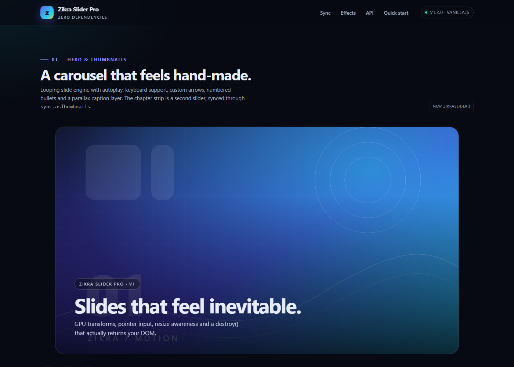

# Zikra Slider Pro

[](https://www.npmjs.com/package/zikra-slider-pro)
[](LICENSE)
[](https://akhtar1985.github.io/zikra-slider-pro/)

**A small, accessible carousel engine for sites that care about weight and keyboard users.**

```bash
npm install zikra-slider-pro
```

Zikra Slider Pro runs in Vanilla JS, React, Next.js App Router and Vue 3 without owning your stack: one ~16 kB (gzip) file, seven layouts, an optional animation ladder (GSAP / anime.js / Motion One → WAAPI → CSS), and accessibility that is on by default instead of an add-on module. Prefer no build step? Use the [CDN snippet](#cdn) below.

- **Small and auditable.** 16 kB gzipped, one ES module, no runtime dependencies, no build step required. Read the whole engine in an afternoon.
- **Accessible by default.** Roles, labels, live-region announcements, `inert` off-screen slides, keyboard support and reduced-motion handling ship on; nothing extra to install or configure.
- **Seven layouts, your motion.** `slide`, `fade`, `scale`, `coverflow`, `stack`, `cards`, or a `custom` transform function — on `x` or `y`, LTR or RTL, with built-in parallax.
- **Brings its own fallbacks.** Uses GSAP, anime.js or Motion One when you already have them; degrades to the Web Animations API, then CSS.
- **Leaves no trace.** `destroy()` restores your original classes, inline styles, ids and ARIA state — safe for SPA route changes and React StrictMode.
- **Survives real life.** Missing libraries, too few slides, hidden containers, broken images and repeated init/destroy cycles all degrade quietly.

## Live demo

**[▶ Open the live demo](https://akhtar1985.github.io/zikra-slider-pro/)** — deployed from `main` by GitHub Actions on every push.

[](https://akhtar1985.github.io/zikra-slider-pro/)

Jump straight to a section:

- [Hero & thumbnails](https://akhtar1985.github.io/zikra-slider-pro/examples/#hero) — loop, autoplay, synced thumbnail strip, parallax captions
- [Gallery](https://akhtar1985.github.io/zikra-slider-pro/examples/#gallery) — lazy images, fraction bullets, progress-synced filmstrip
- [Effects](https://akhtar1985.github.io/zikra-slider-pro/examples/#effects) — fade, coverflow with GSAP fallback, stacked cards
- [Playground](https://akhtar1985.github.io/zikra-slider-pro/examples/#playground) — drag, wheel, breakpoints, `destroy()` → rebuild

## Why Zikra Slider Pro?

Swiper is older, bigger, and has plugins Zikra does not. This project is a deliberate trade: a much smaller surface focused on accessible semantics, a clean destroy/restore lifecycle, and an animation backend you can swap.

| | Zikra Slider Pro | Swiper |
| --- | --- | --- |
| Size | ~16 kB gzip JS + 1.8 kB CSS | ~30–40 kB gzip depending on modules |
| Runtime dependencies | None | None |
| Accessibility | Roles, live region, `inert` off-screen slides, keyboard, reduced motion — on by default | ARIA roles and labels built in; no live-region announcements or `inert` off-screen slides |
| Framework support | Vanilla, packaged React component, works directly in Next/Vue | React/Vue/Angular/Svelte wrappers |
| Effects | 7 layouts + custom transform function; flip/stagger as transitions | cube, flip, coverflow, cards, creative, zoom and more |
| Animation engines | GSAP / anime.js / Motion One → WAAPI → CSS | Built-in engine |
| Virtual slides, huge datasets | Not built in | Yes |
| Ecosystem | New and small | Large plugin and community ecosystem |
| Lifecycle | Full DOM/ARIA restore on `destroy()` | `destroy()` available |

**Choose Swiper** when you need virtual slides, dozens of plugins, or Angular/Svelte wrappers. **Choose Zikra** when you want a small engine you can read and audit, accessible behavior that cannot be forgotten, and motion that follows the libraries you already load.

## Design principles

- **One compute pass.** Every layout produces the same per-slide style descriptor, so slide, fade, coverflow, cards, parallax and sync all share one render path.
- **One transition plan.** Whichever backend runs, the engine plans the same from/to pairs once — falling back is a strategy swap, not a rewrite.
- **The DOM belongs to you.** Clones are inert, user markup is snapshotted on init and restored on `destroy()`.
- **Fail quietly, never loudly.** Bad options are ignored, missing animation libraries fall back, and every public method is a safe no-op on a destroyed instance.

## Contents

- [Live demo](#live-demo)
- [Why Zikra Slider Pro?](#why-zikra-slider-pro)
- [Design principles](#design-principles)
- [Quick start](#quick-start)
- [Markup](#markup)
- [Options](#options)
- [Events and plugins](#events-and-plugins)
- [Instance API](#instance-api)
- [Syncing sliders](#syncing-sliders)
- [Animation backends](#animation-backends)
- [Framework wrappers](#framework-wrappers)
- [CSS classes and variables](#css-classes-and-variables)
- [Accessibility](#accessibility)
- [Project layout](#project-layout)
- [Demo](#demo)
- [Testing](#testing)
- [Continuous integration](#continuous-integration)
- [License](#license)

## Quick start

### npm

```bash
npm install zikra-slider-pro
```

### Script tag (UMD)

```html
<link rel="stylesheet" href="dist/zikra-slider.css">
<script src="dist/zikraslider.umd.js"></script>
<script>
  const slider = zikraslider('#hero', {
    type: 'slide',
    loop: true,
    slidesPerView: 1,
    features: { autoplay: { enabled: true, delay: 5000 } }
  });
</script>
```

`window.zikraslider` is both a factory and a class, so `new zikraslider(...)` works too. `window.zikraslider.ZikraSlider` exposes the class directly.

### Complete HTML page

Save this as `index.html`, open it, and you have a working slider — CDN files, markup and init in one file (no build step, no dependencies):

```html
<!doctype html>
<html lang="en">
<head>
  <meta charset="utf-8">
  <meta name="viewport" content="width=device-width, initial-scale=1">
  <title>Zikra Slider Pro test</title>
  <link rel="stylesheet" href="https://cdn.jsdelivr.net/npm/zikra-slider-pro@1.2.1/dist/zikra-slider.css">
</head>
<body>

  <!-- Slides are direct children of the root. Do not add viewport/track yourself. -->
  <div id="hero" class="zs-slider zs-no-js" aria-label="Photo gallery" style="max-width: 900px; margin: 40px auto;">
    <div class="zs-slide"></div>
    <div class="zs-slide"></div>
    <div class="zs-slide"></div>
  </div>

  <script src="https://cdn.jsdelivr.net/npm/zikra-slider-pro@1.2.1/dist/zikraslider.min.js"></script>
  <script>
    const slider = zikraslider('#hero', {
      loop: true,
      features: { autoplay: { enabled: true, delay: 4000 } }
    });
  </script>

</body>
</html>
```

Arrows and bullet pagination are on by default; autoplay is enabled above via `features.autoplay`. The markup rules are explained in [Markup](#markup), and a bigger real-world page is in [`examples/index.html`](examples/index.html).

### CDN

No build step — load the stylesheet and the UMD bundle:

```html
<link rel="stylesheet" href="https://cdn.jsdelivr.net/npm/zikra-slider-pro@1.2.1/dist/zikra-slider.css">
<script src="https://cdn.jsdelivr.net/npm/zikra-slider-pro@1.2.1/dist/zikraslider.min.js"></script>
<script>
  zikraslider('#hero', { loop: true, bullets: { enabled: true } });
</script>
```

Direct links to every published file (script, CSS, ESM, types, React):

| File | Use it for | Link |
| --- | --- | --- |
| `zikraslider.min.js` | UMD script tag (what the snippet above loads) | https://cdn.jsdelivr.net/npm/zikra-slider-pro@1.2.1/dist/zikraslider.min.js |
| `zikra-slider.css` | required stylesheet | https://cdn.jsdelivr.net/npm/zikra-slider-pro@1.2.1/dist/zikra-slider.css |
| `zikraslider.esm.min.js` | ESM `<script type="module">` | https://cdn.jsdelivr.net/npm/zikra-slider-pro@1.2.1/dist/zikraslider.esm.min.js |
| `zikraslider.esm.js` | unminified ESM (debugging) | https://cdn.jsdelivr.net/npm/zikra-slider-pro@1.2.1/dist/zikraslider.esm.js |
| `zikraslider.cjs` | CommonJS | https://cdn.jsdelivr.net/npm/zikra-slider-pro@1.2.1/dist/zikraslider.cjs |
| `zikraslider.d.ts` | TypeScript types | https://cdn.jsdelivr.net/npm/zikra-slider-pro@1.2.1/dist/zikraslider.d.ts |
| `ZikraSlider.js` | React component (JSX-free) | https://cdn.jsdelivr.net/npm/zikra-slider-pro@1.2.1/react/ZikraSlider.js |

Browse the whole package at https://cdn.jsdelivr.net/npm/zikra-slider-pro@1.2.1/ (or https://www.jsdelivr.com/package/npm/zikra-slider-pro).

- unpkg works the same way: `https://unpkg.com/zikra-slider-pro@1.2.1/dist/…`.
- Pin a version (`@1.2.1`) or a major range (`@1`); avoid `latest` in production.
- A brand-new package name shows a `0.0.0-stage` placeholder and holds back the tarball for a few minutes while npm runs its malware scan; the release becomes installable automatically once the scan finishes.

### ES modules

```js
import zikraslider, { ZikraSlider } from 'zikra-slider-pro';
import 'zikra-slider-pro/css';

const slider = zikraslider('#hero', { loop: true });
const same = new ZikraSlider('#hero', { loop: true });
```

The module is safe to import during SSR: it only touches `window`/`document` when an instance is created.

TypeScript declarations ship with the package (`dist/zikraslider.d.ts`): options are deep-optional, event payloads are typed, and a `beforeChange` handler returning `false` is accepted by the signature.

For a CDN build, `dist/zikraslider.min.js` (UMD) and `dist/zikra-slider.css` are the production files — see [CDN](#cdn) above.

### CommonJS

```js
const zikraslider = require('zikra-slider-pro'); // dist/zikraslider.cjs
```

## Markup

Slides are the **direct children** of the slider root. The plugin wraps them in `.zs-viewport > .zs-track`; you do not write that yourself.

```html
<div id="hero" class="zs-slider zs-no-js">
  <div class="zs-slide"></div>
  <div class="zs-slide"></div>
  <div class="zs-slide"></div>
</div>
```

- `zs-slider` and `zs-slide` are optional but recommended to avoid a flash before initialization.
- `zs-no-js` is removed on init and makes the slides readable/scrolling without JavaScript. If you use a custom name, pass `fallback.noJsClass` and use that class in the markup.
- Give images `width`/`height` attributes or CSS `aspect-ratio` so height is stable before media loads.
- The plugin records and restores your original class names, inline styles and ids on `destroy()`.

## Options

Deep-merged over the defaults. Unknown values are ignored, never thrown. `animation` functions and callbacks are kept as-is.

### Layout

| Option | Type | Default | Description |
| --- | --- | --- | --- |
| `type` | `'slide' \| 'fade' \| 'scale' \| 'coverflow' \| 'stack' \| 'cards' \| 'custom'` | `'slide'` | Layout engine. `custom` calls `custom.transform`. |
| `axis` | `'x' \| 'y'` | `'x'` | Scroll axis (also flips drag and wheel math). |
| `dir` | `'ltr' \| 'rtl'` | `'ltr'` | Sets `dir="rtl"` on the root and mirrors drag direction. |
| `slidesPerView` | `number \| 'auto'` | `1` | Fractional values are supported. `'auto'` measures each slide's content width. |
| `slidesToScroll` | `number` | `1` | Step used by arrows, keyboard and drag-release. |
| `gap` | `number` | `0` | Gap in pixels between slides (all axes). |
| `centeredSlides` | `boolean` | `false` | Centers the active slide in the viewport. |
| `freeMode` | `boolean` | `false` | Drag momentum without snap-to-slide. |
| `loop` | `boolean` | `false` | `slide` clones two boundary slides; other types use cyclic math. |
| `initialSlide` | `number` | `0` | Clamped to the real slide range. |
| `autoHeight` | `boolean` | `false` | Animates viewport height to the active slide (`axis: 'x'` only). |
| `speed` | `number` | `480` | Default transition duration in ms. |
| `classPrefix` | `string` | `'zs-'` | Prefix for all generated classes. |

### `parallax`

Off by default. When enabled, matched **descendants of each slide** are translated opposite to the slide's travel, so they appear to move slower and create depth.

```js
parallax: {
  enabled: true,
  selector: '.slide-media', // any valid CSS selector, resolved inside each slide
  factor: 0.2               // 0 = static, 0.2 = subtle, 0.5 = strong
}
```

| Option | Type | Default | Description |
| --- | --- | --- | --- |
| `enabled` | `boolean` | `false` | Turns the parallax layer on. |
| `selector` | `string` | `'[data-zs-parallax]'` | Queried inside every slide (clones included). |
| `factor` | `number` | `0.2` | Travel ratio. Negative values reverse the direction. |

- Override the factor per element with `data-zs-parallax="0.35"`; an empty attribute uses the global factor. Matching the default selector means markup-only opt-in.
- Offsets are recomputed in the same pass as the slide transforms, so they stay correct during drag, momentum, free mode and progress syncing.
- Inner elements are animated with the **same backend, duration, delay and easing as the slides** (GSAP/anime/Motion/WAAPI/CSS).
- Parallax elements become transform/transition targets: avoid your own `transform` animations and CSS transitions on them. Original inline styles are restored by `update()` and `destroy()`.
- Oversize the image (or use a clipped wrapper) by at least `factor × slide width` so no gap appears at the edges — see the gallery demo.

### `type: 'custom'`

Apply your own layout math per slide. The callback receives the live cyclic position, so loop, drag, autoplay and free mode keep working.

```js
type: 'custom',
custom: {
  transform({ relative, axis, slideSize, viewportSize }) {
    const abs = Math.abs(relative);
    if (abs > 2) return { opacity: 0, visible: false };
    const drift = (axis === 'x' ? slideSize * 0.55 : slideSize * 0.4) * relative;
    return {
      x: axis === 'x' ? drift : relative * 14,
      y: axis === 'y' ? drift : abs * 22,
      z: -abs * 80,
      scale: 1 - abs * 0.1,
      rotate: relative * -3,
      opacity: 1 - abs * 0.35,
      zIndex: 100 - Math.round(abs * 10)
    };
  }
}
```

Callback payload: `{ index, realIndex, relative, activeIndex, total, viewportSize, slideSize, axis, dir, loop }`. `relative` is `0` for the active slide, `±1` for its neighbours (cyclic in loop mode), and continuous during drag.

Return any of `x`, `y`, `z`, `scale`, `rotate`, `rotateY`, `opacity`, `zIndex` (px / degrees), plus optional `visible` and `interactive`. Defaults: `opacity` 1, `scale` 1, z-index from closeness; `visible`/`interactive` follow opacity, which also drives `aria-hidden` and `inert`. Missing or throwing callbacks log once and fall back to neutral styles — the slider never breaks.

### `sync`

| Option | Type | Default | Description |
| --- | --- | --- | --- |
| `with` | selector \| element \| instance \| array | `null` | Slider(s) to follow this one. |
| `mode` | `'index' \| 'progress'` | `'index'` | Follow slide index changes, or continuous drag progress. |
| `asThumbnails` | `boolean` | `false` | Marks the target root `data-zs-thumbnails` and makes its slides clickable selectors. |

### `arrows`

| Option | Type | Default | Description |
| --- | --- | --- | --- |
| `enabled` | `boolean` | `true` | Render arrows. |
| `prevEl` / `nextEl` | selector \| element | `null` | Use your own buttons. They receive `.zs-arrow`/`.zs-arrow-prev|next` classes. |
| `container` | selector \| element | `null` | Where to inject generated arrows when no custom buttons are supplied. |
| `className` | `string` | `''` | Extra class on generated arrows (and the overlay wrapper). |
| `prevClass` / `nextClass` | `string` | `''` | Per-direction extra classes. |
| `prevHtml` / `nextHtml` | `string` (HTML) | arrow SVGs | Content of generated arrows. |
| `ariaPrevLabel` / `ariaNextLabel` | `string` | `'Previous slide'` / `'Next slide'` | Accessible labels. |
| `hideAtEdges` | `boolean` | `false` | Hide arrows at the first/last slide in non-loop mode. |
| `render` | `({ direction, index, total }) => string \| Node` | `null` | Dynamic arrow content, evaluated on every control update. |

### `bullets`

| Option | Type | Default | Description |
| --- | --- | --- | --- |
| `enabled` | `boolean` | `true` | Render pagination. |
| `el` | selector \| element | `null` | External container (keeps its position; gets `.zs-bullets`). |
| `type` | `'bullets' \| 'fraction' \| 'progressbar' \| 'custom'` | `'bullets'` | `custom` renders bullet content with `render`. |
| `clickable` | `boolean` | `true` | Bullets call `goTo()`. |
| `dynamicBullets` | `boolean` | `false` | With more than 7 slides, show a window of 5 around the active bullet. |
| `className` | `string` | `''` | Extra class on the container. |
| `bulletClass` | `string` | `''` | Extra class on every bullet. |
| `activeClass` | `string` | `''` | Override the active bullet class (default `.zs-bullet-active` is still applied). |
| `formatFraction` | `(current, total) => string` | `'1 / 3'` | Fraction text formatter. |
| `render` | `({ index, isActive, total }) => string \| Node` | `null` | Bullet content renderer (`bullets` / `custom`). |

### `features`

```js
features: {
  autoplay: {
    enabled: false,
    delay: 4200,
    pauseOnHover: true,
    pauseOnFocus: true,
    pauseOnHiddenTab: true,
    stopOnInteraction: false
  },
  drag: { enabled: true, threshold: 6, velocity: 0.4, rubberband: true },
  keyboard: { enabled: true, onlyWhenFocused: true },
  wheel: { enabled: false, passive: true },
  lazyLoad: { enabled: false, mode: 'adjacent', placeholder: '' },
  a11y: { enabled: true, roleDescription: 'carousel', liveRegion: true }
}
```

- **autoplay** stops at the last slide when `loop` is off. `stopOnInteraction` also stops it permanently after any arrow/bullet/drag/keyboard input.
- **drag** uses Pointer Events and ignores gestures that are more vertical than horizontal (so page scrolling still works). `threshold` is px, `velocity` is px/ms.
- **keyboard** supports `←/→/↑/↓`, `Home`, `End`, `PageUp`, `PageDown` (left/right follow `dir`). By default the listener lives on the slider root, so pages with several sliders do not fight. `onlyWhenFocused: false` uses a document-level listener that still ignores form fields and events originating inside another slider.
- **wheel** is throttled to one step per 320 ms. `passive: false` lets it prevent page scroll while the pointer is over the slider.
- **lazyLoad** reads `data-zs-src` and `data-zs-srcset`, optionally sets `placeholder`, and notifies `fallback.onMediaError` on failures. Modes: `onDemand` (current slide), `adjacent` (current + neighbors), `eager` (all).
- **a11y** toggles region/slide roles, labels and the visually hidden live region.

### `responsive`

A mobile-first map of `min-width` → partial options. The **largest** matching breakpoint wins; listeners reload the instance automatically when the viewport crosses a breakpoint.

```js
responsive: {
  0:   { slidesPerView: 1 },
  640: { slidesPerView: 2, gap: 12 },
  1024:{ slidesPerView: 3, gap: 20 }
}
```

### `animation`

| Option | Type | Default | Description |
| --- | --- | --- | --- |
| `library` | `'auto' \| 'none' \| 'gsap' \| 'anime' \| 'motion' \| object` | `'auto'` | Which backend to try. `auto` probes GSAP → anime.js → Motion One. |
| `effect` | `'slide' \| 'fade' \| 'zoom' \| 'slide-up' \| 'flip' \| 'stagger'` | `'slide'` | Transition flavour layered over the layout. |
| `duration` | `number \| null` | `null` | Falls back to `speed`. |
| `ease` | `string` | `'cubic-bezier(0.22, 0.61, 0.36, 1)'` | Used by CSS and WAAPI. Library adapters receive it only when it is not a CSS timing function (otherwise they use their native default). |
| `fallback` | `'css' \| 'waapi'` | `'css'` | What to use when the library is absent or fails. |

`type: 'scale'` is a **layout**: neighbouring slides sit scaled-down behind the active one. `effect: 'zoom'` is a **transition**: the incoming slide starts at 86% scale and fades in, layered over any layout (`slide`, `cards`, `coverflow`, even `scale`). Use the layout for the resting composition and the effect for the movement.

### `fallback`

| Option | Type | Default | Description |
| --- | --- | --- | --- |
| `disableIfNotEnoughSlides` | `boolean` | `true` | Disable navigation when all slides already fit. |
| `reducedMotion` | `'fade' \| 'instant' \| 'ignore'` | `'fade'` | Behaviour when `prefers-reduced-motion: reduce` matches. |
| `noJsClass` | `string` | `'zs-no-js'` | Class removed on init and usable as a CSS fallback. |
| `onMediaError` | `(imgEl, src) => void` | `null` | Lazy image failure hook. |

## Events and plugins

`on` accepts one function or an array of functions per event. The same handlers can be attached or removed later with `slider.on(name, fn)` / `slider.off(name, fn)`. Every callback runs inside `try/catch`, so a throwing handler is logged and never breaks the slider.

```js
const slider = zikraslider('#hero', {
  on: {
    init({ instance }) {
      console.log('ready on slide', instance.getState().index);
    }
  }
});

const onSlide = ({ index }) => console.log('now on', index);
slider.on('afterChange', onSlide);
slider.off('afterChange', onSlide);
```

### `beforeChange` — guard a change

Runs before any navigation that moves the index — arrows, bullets, thumbnails, drag release, autoplay, keyboard (`reason` is `arrow`, `bullet`, `thumbnail`, `drag`, `autoplay`, `next`/`prev`), `next()`, `prev()` and `goTo()`. Return `false` to **cancel**: the slider stays on `previousIndex`, and a drag release snaps back. Progress-synced partner sliders (`reason: 'sync'`) move silently and do not fire `beforeChange`.

```js
let formDirty = false;

const hero = zikraslider('#hero', {
  on: {
    beforeChange({ index, previousIndex, reason }) {
      if (formDirty && !window.confirm(`Leave slide ${previousIndex + 1} without saving?`)) {
        return false; // cancel — the active slide does not change
      }
      console.log(`#${previousIndex} → #${index} (${reason})`);
    },
    afterChange({ index }) {
      history.replaceState(null, '', `#slide-${index + 1}`);
    }
  }
});

// ...mark formDirty = true while editing; save() clears it.
```

- Returning `false` still lets autoplay keep its timer running — it simply skips that tick, so pair a permanent block with `slider.pause()` if needed.
- `reason` tells you what triggered the move, so you can allow some paths and block others:

```js
beforeChange({ reason }) {
  if (reason === 'autoplay' && document.hidden) return false;
}
```

### `progress` — drive a progress UI

Fires for the whole travel, not just at the end: transitions, free-mode drags, momentum and progress-synced slides update it every frame. `progress` is `0…1` across the real slides; `index` is the active index.

```js
const fill = document.querySelector('[data-read-progress]');
const label = document.querySelector('[data-progress-label]');

const story = zikraslider('#story', {
  on: {
    progress({ progress, index }) {
      fill.style.transform = `scaleX(${progress})`;
      label.textContent = `Slide ${index + 1} of ${story.getState().total}`;
    }
  }
});
```

The handler runs after init, so closing over the `story` variable is safe. Keep heavy work out of it — it can fire on every animation frame; batch React state updates or throttle if needed.

### `destroy` — clean up after yourself

Fires first inside `destroy()`, before listeners, timers and observers are removed and before your markup is restored — so the instance is still fully readable.

```js
const closeButton = document.querySelector('[data-lightbox-close]');

const lightbox = zikraslider('#lightbox', {
  on: {
    destroy({ instance }) {
      const { index, total } = instance.getState();
      sessionStorage.setItem('last-slide', `${index}/${total}`);
      closeButton.removeEventListener('click', onClose);
      console.log('slider torn down');
    }
  }
});

const onClose = () => lightbox.destroy();
closeButton.addEventListener('click', onClose);
```

`destroy()` is idempotent: calling it twice emits nothing the second time and leaves the restored DOM untouched.

### Plugins — package the pattern

A plugin is an object with a callable `init(instance)`. After init succeeds the slider also calls optional `onChange(instance, payload)` and `destroy(instance)` hooks. Errors in any hook are logged and ignored, exactly like event handlers.

```js
function analyticsPlugin(track) {
  let changes = 0;

  return {
    name: 'analytics',

    init(instance) {
      track('slider_init', { total: instance.getState().total });
    },

    // Fires after every completed slide change, after afterChange listeners.
    onChange(instance, { index, previousIndex, reason }) {
      changes += 1;
      track('slide_change', { index, previousIndex, reason, changes });
    },

    // Fires inside destroy(), before the DOM is restored.
    destroy(instance) {
      track('slider_destroy', { changes, endedOn: instance.getState().index });
    }
  };
}

zikraslider('#hero', {
  plugins: [
    analyticsPlugin((event, props) =>
      navigator.sendBeacon('/track', JSON.stringify({ event, ...props }))
    )
  ]
});
```

- `plugins` takes an array (nested arrays are flattened); an object without an `init` function is ignored.
- Argument order differs by design: `init(instance)`, `onChange(instance, payload)`, `destroy(instance)`.
- Plugins observe; they cannot cancel a change — that is `beforeChange`'s job.
- Plugin `onChange` runs **after** `afterChange` handlers, so both see the same `{ index, previousIndex, reason }`.
- A plugin that throws during `init` is skipped entirely and never receives later hooks.

Event `reason` values include `api`, `next`, `prev`, `arrow`, `bullet`, `drag`, `thumbnail`, `autoplay`, `sync` and whatever you pass to `goTo(index, { reason })`.

## Instance API

```js
slider.next();                  // step = slidesToScroll
slider.prev();
slider.goTo(3, { reason: 'menu', speed: 300 });
slider.play();
slider.pause();
slider.toggleAutoplay();
slider.update({ slidesPerView: 2 });  // deep-merged, keeps the current index
slider.recalculate();                 // re-measure after layout changes
slider.getProgress();                 // 0…1
slider.getState();                    // see below
slider.on('afterChange', fn);
slider.off('afterChange', fn);
slider.destroy();                     // removes listeners/timers/observers and restores the DOM
```

`getState()` returns:

```js
{
  index, realIndex, progress, total,
  slidesPerView, isLooping,
  isAutoplay, isAutoplayRunning,
  isAnimating, isDragging,
  isDisabled, isDestroyed, isBroken,
  type, axis, dir, backend
}
```

Static helpers:

```js
zikraslider.get('#hero');       // existing instance or undefined
zikraslider.instances();        // array of live instances
zikraslider.defaults;           // default options object
zikraslider.VERSION;            // '1.2.1'
```

Creating an instance on a missing element or without a DOM returns a safe stub whose methods are no-ops, so code paths do not crash during SSR.

## Syncing sliders

The slider that declares `sync` is the source; targets follow it. Targets created later are picked up automatically.

```js
const main = zikraslider('#gallery', {
  sync: { with: '#gallery-thumbs', mode: 'progress', asThumbnails: true }
});

zikraslider('#gallery-thumbs', {
  slidesPerView: 4,
  gap: 10,
  arrows: { enabled: false },
  bullets: { enabled: false }
});
```

- `mode: 'index'` — target jumps when the source settles (hero ↔ thumbnails).
- `mode: 'progress'` — target follows drag position frame by frame and also receives the final index.
- `asThumbnails: true` adds `data-zs-thumbnails` to the target and binds click handlers to its slides. CSS can therefore style the active thumb:

```css
.hero-thumbs[data-zs-thumbnails] .zs-slide-active .thumb-card { outline: 2px solid var(--accent); }
```

Internal `_syncOrigin` guards prevent two sliders from echoing changes back and forth. Only declare `sync` on one side unless you deliberately want bidirectional control.

## Animation backends

Resolution order for each transition:

1. The requested library (`auto` tries GSAP, then anime.js v3/v4, then Motion One).
2. If the library is missing, a throwing adapter, or `library: 'none'`:
   - WAAPI when `animation.fallback: 'waapi'` and `Element.animate` exists.
   - CSS transitions otherwise (start values are flushed with a forced reflow).

The backend actually used last is reported as `getState().backend` (`'gsap'`, `'anime'`, `'motion'`, `'custom'`, `'waapi'`, `'css'`). Built-in adapters animate `x`, `y`, `z`, `scale`, `rotate` (rotateZ), `rotateY` and `opacity`, so 3D layouts such as `cards` and the `flip` effect stay smooth on every backend. Parallax elements are queued as extra items in the same plan and ride the same backend and timing; a custom adapter receives them as `{ x, y }` targets with neutral scale/rotation/opacity.

### Custom adapter

```js
animation: {
  library: {
    fromTo(el, from, to, { duration, delay, easing }) {
      // from/to: { x, y, z, scale, rotate, rotateY, opacity, zIndex }
      return animateSomething(el, from, to, duration, delay, easing);
    }
  },
  effect: 'fade',
  duration: 500
}
```

Returning a promise is supported; the engine also runs a timeout so a hung animation cannot freeze navigation.

### Reduced motion

With `prefers-reduced-motion: reduce`, the default `reducedMotion: 'fade'` jumps transforms and cross-fades in ≤220 ms. Use `'instant'` for no animation, or `'ignore'` to opt out.

## Framework wrappers

### Packaged React component

```jsx
import { useRef } from 'react';
import 'zikra-slider-pro/css';
import { ZikraSlider } from 'zikra-slider-pro/react';

export default function Hero() {
  const api = useRef(null);

  return (
    <>
      <ZikraSlider
        ref={api}
        aria-label="Highlights"
        options={{
          loop: true,
          features: { autoplay: { enabled: true, delay: 5000 } },
          bullets: { type: 'fraction', formatFraction: (c, t) => `${c} / ${t}` }
        }}
      >
        <div className="zs-slide">…</div>
        <div className="zs-slide">…</div>
      </ZikraSlider>
      <button onClick={() => api.current.next()}>Next</button>
    </>
  );
}
```

The `ref` exposes `{ instance, next, prev, goTo, play, pause, update, getState }`, and `onInit(instance)` receives the raw engine instance. React 18+ is an optional peer dependency — the core package stays framework-free. Options are read at mount; use `api.current.update(...)` for runtime changes.

Ready-to-copy components for other setups live in `examples/`:

| Framework | File |
| --- | --- |
| React | `examples/react/ZikraSlider.jsx` |
| Next.js App Router | `examples/nextjs/ZikraSlider.jsx` (`'use client'`) |
| Vue 3 | `examples/vue/ZikraSlider.vue` |

They all create the instance in a mount effect, forward option changes through `update()`, and call `destroy()` on unmount. Slider content should be static (the engine re-parents slide nodes).

### React

```jsx
import { useMemo, useRef } from 'react';
import ZikraSlider from './ZikraSlider';

export default function Hero() {
  const slider = useRef(null);
  const options = useMemo(() => ({
    loop: true,
    slidesPerView: 1,
    features: { autoplay: { enabled: true, delay: 5000 } },
    bullets: { type: 'fraction', formatFraction: (c, t) => `${c} / ${t}` }
  }), []);

  return (
    <>
      <ZikraSlider ref={slider} options={options} aria-label="Highlights">
        <div className="zs-slide">…</div>
        <div className="zs-slide">…</div>
      </ZikraSlider>
      <button onClick={() => slider.current?.next()}>Next</button>
    </>
  );
}
```

### Next.js App Router

The wrapper starts with `'use client'`. Import it from a client component; the server renders the plain `zs-no-js` markup and the effect initializes after hydration. Global CSS may be imported in the component, or once in `app/layout`.

```jsx
'use client';
import ZikraSlider from './ZikraSlider';
import { useMemo } from 'react';
```

Options passed from a Server Component can only be serializable; render callbacks belong in a client component.

### Vue 3

```vue
<script setup>
import ZikraSlider from './ZikraSlider.vue';
</script>

<template>
  <ZikraSlider :options="{ loop: true, slidesPerView: 1 }">
    <div class="zs-slide">…</div>
    <div class="zs-slide">…</div>
  </ZikraSlider>
</template>
```

The wrapper emits `ready` with the instance and exposes the imperative API (`next`, `goTo`, `update`, `getState`, …).

## CSS classes and variables

Generated hooks:

```
.zs-slider        .zs-initialized   .zs-viewport   .zs-track
.zs-slide         .zs-slide-clone   .zs-slide-active   .zs-slide-visible
.zs-arrows        .zs-arrow         .zs-arrow-prev     .zs-arrow-next
.zs-bullets       .zs-bullet        .zs-bullet-active  .zs-fraction
.zs-progressbar   .zs-progressbar-fill
.zs-live          .zs-dragging      .zs-drag-enabled   .zs-animating
.zs-type-slide …  .zs-axis-x …
```

Theme with CSS custom properties on the slider root or at `:root`:

| Variable | Default | Purpose |
| --- | --- | --- |
| `--zs-accent` | `#6366f1` | Active bullet / progress fill. |
| `--zs-ink` | `#0f172a` | Bullet and button ink. |
| `--zs-surface` | `#ffffff` | Fraction background text. |
| `--zs-gap` | `0px` | Gap in the no-JS fallback only; use the `gap` option at runtime. |
| `--zs-radius` | `16px` | Generated arrows radius. |
| `--zs-ease` | `cubic-bezier(0.22, 0.61, 0.36, 1)` | Default easing. |
| `--zs-arrow-size` | `44px` | Generated arrow size. |
| `--zs-arrow-bg` | `rgba(15, 23, 42, .55)` | Generated arrow background. |
| `--zs-arrow-color` | `#ffffff` | Generated arrow icon color. |
| `--zs-arrow-radius` | `999px` | Generated arrow border radius. |
| `--zs-arrow-inset` | `12px` | Arrow overlay inset. |
| `--zs-bullet-size` | `8px` | Bullet diameter. |
| `--zs-bullet-color` | `rgba(15, 23, 42, .22)` | Inactive bullet. |
| `--zs-bullet-active-color` | `var(--zs-accent)` | Active bullet. |
| `--zs-bullets-inset` | `14px` | Pagination offset from the bottom edge. |

Custom arrows supplied through `prevEl`/`nextEl` are not moved; they only receive the `.zs-arrow` classes and labels. Custom bullet containers keep their layout too — style `.zs-bullets` carefully if you do not want absolute positioning.

## Accessibility

- Root: `role="region"`, `aria-roledescription="carousel"`, `tabindex="0"`, `aria-label` (author-provided or `"Image carousel"`).
- Slides: `role="group"`, `aria-roledescription="slide"`, `aria-label="i of n"`, off-screen slides get `aria-hidden="true"` and `inert` so their links stay out of the tab order.
- Cloned loop slides are `inert`, `aria-hidden`, and have ids/`tabindex` stripped. `destroy()` restores the author's original `aria-hidden`/`inert` state.
- A visually hidden `aria-live="polite"` region announces slide changes (120 ms debounce).
- Arrow buttons receive `aria-label`, `aria-disabled` and, at edges, `disabled`/`aria-hidden` when hidden.
- Drag uses explicit `touch-action` so vertical page scrolling is preserved; a post-drag click suppressor prevents accidental link activation.
- `prefers-reduced-motion` is respected. Nothing traps focus, and no keyboard listener is global unless you ask for `onlyWhenFocused: false`.

## Project layout

```
zikra-slider-pro/
├─ src/
│  ├─ zikraslider.js        # engine (ES module source of truth)
│  ├─ zikraslider.d.ts      # public type definitions
│  └─ zikra-slider.css      # .zs-* base styles
├─ dist/
│  ├─ zikraslider.umd.js    # browser global / AMD / CJS build
│  ├─ zikraslider.min.js    # minified UMD
│  ├─ zikraslider.cjs       # CommonJS build
│  ├─ zikraslider.esm.js    # ES module build
│  ├─ zikraslider.esm.min.js
│  ├─ zikraslider.d.ts      # copied declarations
│  └─ zikra-slider.css      # copied stylesheet
├─ react/
│  ├─ ZikraSlider.js        # packaged React component (zikra-slider-pro/react)
│  └─ ZikraSlider.d.ts
├─ tests/                   # vitest + happy-dom engine and wrapper tests
├─ examples/
│  ├─ index.html            # full demo page
│  ├─ demo.css / demo.js    # demo-only styles and bootstrap
│  ├─ assets/art-*.svg      # offline demo artwork
│  ├─ react/ZikraSlider.jsx
│  ├─ nextjs/ZikraSlider.jsx
│  └─ vue/ZikraSlider.vue
├─ scripts/
│  ├─ build.mjs             # esbuild-powered UMD/CJS/ESM build
│  ├─ serve.mjs             # static demo server (no dependencies)
│  └─ gen-assets.mjs        # regenerates the demo SVGs
├─ docs/
│  └─ demo.png              # live-demo screenshot used above
├─ .github/workflows/
│  ├─ ci.yml                # lint · test · typecheck · pack check
│  └─ pages.yml             # builds and deploys the demo to Pages
├─ vitest.config.mjs
├─ tsconfig.json            # declaration typecheck
├─ package.json
├─ LICENSE
└─ README.md
```

`npm run build` regenerates `dist/` from `src/`. The engine itself still has zero runtime dependencies; esbuild, vitest and TypeScript are dev-only tooling.

## Demo

Live: **https://akhtar1985.github.io/zikra-slider-pro/** — or run it locally:

```bash
npm run demo
# builds, then serves http://localhost:4173/examples/
```

## Testing

```bash
npm test           # builds dist, then runs vitest + happy-dom
npm run typecheck  # validates the TypeScript declarations
npm run lint       # eslint flat config (engine, React component, scripts, tests)
```

The suite covers init/a11y, navigation and cancellation, loop wrap, layout transforms, parallax restoration, `custom` transforms, `update()`/`destroy()` markup restoration, autoplay state, pointer drag gestures (threshold, commit, snap-back, RTL, controls, `pointercancel`), and the packaged React component.

## Continuous integration

`.github/workflows/ci.yml` runs the full pipeline on every push and pull request — Node 22 and 24 on Linux, plus Node 24 on Windows: `npm ci`, lint, the test suite, the declaration typecheck, and a package-contents check. `.github/workflows/pages.yml` builds the demo and deploys it to GitHub Pages from `main`.

The demo exercises the deliverable set in one page:

1. **Hero** — loop, autoplay, keyboard (when focused), external custom arrows, custom numbered bullets, a synced thumbnail strip (`sync.asThumbnails`, index mode) and a parallax caption layer.
2. **Gallery** — lazy images, fraction bullets with a custom formatter, progress-synced filmstrip, clickable thumbnails and parallax artwork.
3. **Effects** — fade (CSS), coverflow requesting a missing GSAP (`fallback: 'waapi'`, backend badge updates live), and a stacked-card type.
4. **Playground** — free-mode drag, wheel, responsive breakpoints, live `getState()`, cancellable `beforeChange`, RTL update, and a real `destroy()` → rebuild cycle with the event log.

The page loads only `dist/zikra-slider.css` and `dist/zikraslider.umd.js`; demo code never imports internals. Artwork is generated SVG, so the demo works offline.

## License

MIT. See [LICENSE](LICENSE).
